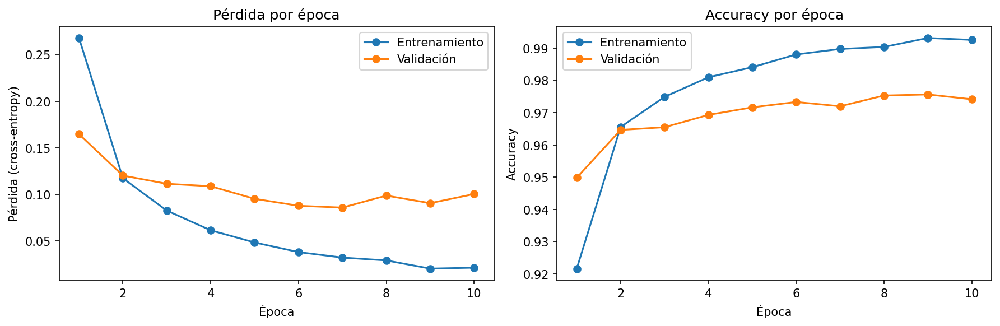

# MNIST con PyTorch: pipeline de entrenamiento y validación

Checkpoint 1 del Proyecto Final. Pipeline base en PyTorch: configuración del entorno, clasificador base (MLP) sobre MNIST, ciclo de entrenamiento con Adam, ciclo de validación y registro de métricas por época.

## Estructura del repositorio
- `data/`: carpeta donde se descarga MNIST (los archivos no se versionan, ver `.gitignore`).
- `notebooks/mnist_pipeline.ipynb`: el pipeline completo, con todas las salidas.
- `notebooks/curvas_entrenamiento.png`: curvas de pérdida y accuracy.
- `requirements.txt`: dependencias con las versiones usadas.

## Entorno
| Componente | Versión |
|---|---|
| Python | 3.13.18 |
| PyTorch | 2.11.0 |
| torchvision | 0.26.0 |
| NumPy | 2.1.3 |
| Matplotlib | 3.10.0 |

- **Dispositivo:** detección automática (`cuda`, luego `mps`, luego `cpu`). Los resultados de este README se obtuvieron en Google Colab con `cpu`.
- **Reproducibilidad:** semilla fija (`SEED = 42`) para `random`, NumPy y PyTorch, y para la partición y el orden de los datos.

## Datos
MNIST (`torchvision`): 60.000 imágenes de entrenamiento, divididas al azar en **54.000 para entrenar y 6.000 para validar**. Las imágenes se normalizan con la media (0,1307) y el desvío (0,3081) de MNIST. El conjunto de test oficial (10.000 imágenes) no se usa en este checkpoint.

## Modelo y configuración
- **Arquitectura:** MLP `Flatten → Linear(784, 128) → ReLU → Linear(128, 10)`, con 101.770 parámetros entrenables. La salida son logits (sin Softmax).
- **Pérdida:** `CrossEntropyLoss`.
- **Optimizador:** Adam, con **`learning_rate = 1e-3`** (el valor estándar de partida; no se ajustó en este checkpoint).
- **Batch size:** 64 | **Épocas:** 10.

## Resultados
Punto de partida (modelo sin entrenar): pérdida 2,299 y accuracy de validación 0,111, lo esperable al adivinar entre 10 clases (ln 10 ≈ 2,303).

| Época | Pérdida train | Acc. train | Pérdida val | Acc. val |
|---|---|---|---|---|
| 1 | 0,2679 | 0,9216 | 0,1648 | 0,9498 |
| 7 | 0,0323 | 0,9898 | 0,0859 | 0,9720 |
| 10 | 0,0215 | 0,9926 | 0,1005 | 0,9742 |

## Interpretación de la curva de pérdida
**Sí, la pérdida bajó.** La pérdida de entrenamiento cayó de 0,2679 a 0,0215 a lo largo de las 10 épocas, y la accuracy de validación llegó a ~97,4 %.

**Señal temprana de overfitting, leve.** La pérdida de validación bajó hasta la época 7 (0,0859) y después dejó de mejorar: osciló entre 0,09 y 0,10, mientras la de entrenamiento siguió bajando. La brecha de accuracy entre entrenamiento (99,26 %) y validación (97,42 %) también se amplió. Con 6.000 ejemplos de validación, parte de esa oscilación puede ser ruido, así que se la toma como señal temprana y no como una conclusión firme.

**Nota:** en la época 1 la pérdida de validación es menor que la de entrenamiento porque la de entrenamiento promedia toda la época (incluidas las primeras tandas, cuando el modelo casi no había aprendido) y la de validación se mide al final.

## Cómo reproducirlo
1. Instalar las dependencias: `pip install -r requirements.txt`
2. Abrir `notebooks/mnist_pipeline.ipynb` (en Colab o en local) y ejecutar todas las celdas en orden. Tarda unos 2 minutos en CPU. MNIST se descarga solo.

Con la semilla fija, al reiniciar el entorno y ejecutar todo, los resultados coincidieron hasta el cuarto decimal. En GPU pueden aparecer pequeñas variaciones.
